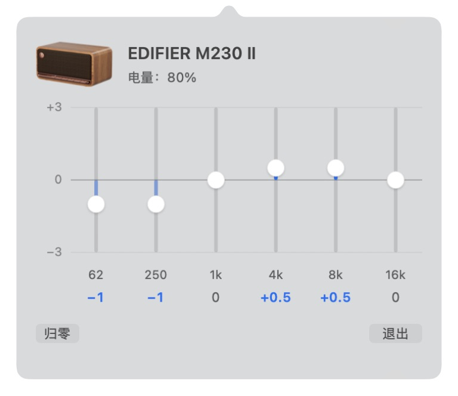

# M230 Controller

用于 **EDIFIER M230 Ⅱ / M230 II（二代）** 的原生 macOS 菜单栏控制器：查看电量、调节设备内置六段 EQ。

不是系统软件均衡器，不处理电脑音频流，也不是漫步者官方应用。BLE 命令已经在一台固件 **1.0.2** 的 M230 二代上验证；其他型号和固件尚未验证。



## 功能

- 点击菜单栏音箱图标展开半透明面板，点外部或按 Esc 收起。
- 顶部展示音箱缩略图、名称和实时电量。
- 六段 EQ：**62 / 250 / 1k / 4k / 8k / 16k Hz**，范围 **−3～+3 dB**，步进 **0.5 dB**。
- 纵向圆点推子从 0 线向正负方向填充；非零增益强调显示，支持方向键和辅助功能操作。
- 松开推子后发送设置，后台读回确认，快速操作合并排队；只在失败时提示。
- “归零”一次恢复六段到 0 dB。
- 每次展开面板时刷新状态，后台也会定期刷新。
- 自动发现 M230 二代，核对协议设备名以及广播/协议返回的地址后才开放操作；不包含作者的设备地址。

## 构建与运行

需要 macOS 13+、Xcode Command Line Tools（Swift 5.9+）。目前实测环境为 Apple Silicon Mac；尚未在 Intel Mac 验证。

```sh
git clone https://github.com/No-22-Github/edifier-m230-controller.git
cd edifier-m230-controller
swift test
./scripts/build-app.sh
open "dist/M230 Controller.app"
```

首次构建会从漫步者官网获取产品图片。没有 Swift Package 外部依赖；运行时不联网。构建产物、下载图片及本机调试文件不提交到仓库。

应用只显示在菜单栏，没有 Dock 图标。首次启动请允许蓝牙访问。手机上的漫步者 APP 可能占用 BLE 控制通道；如一直等待连接，先关闭 APP 的设备连接或临时关闭手机蓝牙，电脑蓝牙音频可以保持连接。

同时存在多台同款音箱时，当前版本会连接首先发现并验证的设备，尚无设备选择器；请只开启需要控制的那台。同款设备改名后，严格的名称核对也可能不通过，请先在官方 APP 恢复名称 `EDIFIER M230 Ⅱ`。

## 关于反复请求蓝牙授权

macOS 会根据应用的签名身份记住授权。临时签名（ad-hoc）绑定具体代码版本，每次重新编译可能再次请求授权。

构建脚本优先使用钥匙串中的 Apple Development / Developer ID Application 身份，没有可用证书才使用 ad-hoc。也可显式固定身份：

```sh
M230_SIGNING_IDENTITY='Apple Development: Your Name (TEAMID)' ./scripts/build-app.sh
# 没有开发证书时，明确选择临时签名：
M230_SIGNING_IDENTITY=- ./scripts/build-app.sh
```

后续更新保持同一个 Bundle ID 和签名身份。更换证书类型、应用身份或清除系统授权记录后仍可能需要重新授权。本项目未公证；当前不提供已公证的二进制下载。

参考：[Apple — Inside Code Signing: Requirements](https://developer.apple.com/documentation/technotes/tn3127-inside-code-signing-requirements)。

## 协议与验证

详见 [协议记录](docs/protocol.md)。硬件验证包括电量读取、六段分别执行 0 → +0.5 → 0 dB 并确认其他段不变，以及原生界面的正/负增益、排队写入、归零和原值恢复。测试使用的私人原始日志不会公开。

`swift test` 不连接蓝牙，覆盖真实帧向量、校验/长度错误、通知分片与合并、畸形 EQ 数据、所有增益档位。CI 在 macOS 上运行协议测试和应用编译；它不代表实机蓝牙或完整界面验收。

需要本机诊断日志时：

```sh
M230_DEBUG_LOG=1 "dist/M230 Controller.app/Contents/MacOS/M230Controller"
```

日志保存在 `~/Library/Application Support/M230Controller/session.log`，可能包含设备地址和设备标识。提交问题时请先脱敏。默认不写调试日志。

## 目录

```text
Sources/M230Controller/   AppKit 菜单栏、推子、CoreBluetooth 控制
Sources/M230Core/         帧编解码、通知重组、M230 II EQ 数据结构
Tests/M230CoreTests/      不依赖硬件的协议测试
Resources/               应用清单、图片来源说明
scripts/                 构建和图片获取
```

## 致谢与许可

协议研究参考了：

- [rioriost/edf-controller](https://github.com/rioriost/edf-controller)：S880DB MKII 的 macOS 控制和六段 EQ。
- [kralonur/edifier-speakers-ble](https://github.com/kralonur/edifier-speakers-ble)：M60/M90 的详细帧格式、命令和验证记录。
- [Devis99/omarchy-edifier-mr5](https://github.com/Devis99/omarchy-edifier-mr5)：MR5 的命令及电量查询线索。

M230 二代与这些产品共用部分命令编号，但服务 UUID、帧内标识和 EQ 数据结构不能直接混用。参考仓库的 MIT 声明保留在 [LICENSES](LICENSES)。

本项目代码使用 [MIT License](LICENSE)。Edifier 产品图片和商标归原权利人所有，不属于本项目 MIT 授权范围；图片从官网按需获取，详见 [资源说明](Resources/README.md)。
